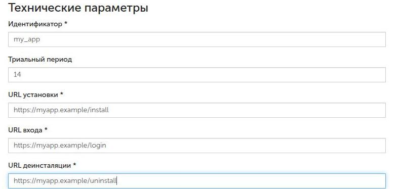
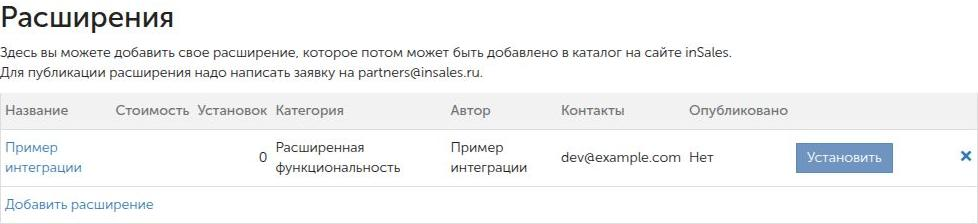
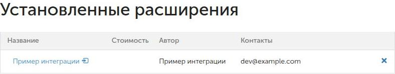

# Как интегрироваться с InSales

Через API бэк-офиса приложение может создавать, читать, изменять и удалять объекты магазина: товары, заказы, клиентов и остальные ресурсы из [справочника InSales API](https://api.insales.ru/).

Чтобы приложение получило доступ к магазину, сначала [настройте и установите его](#настройка-приложения). При установке InSales сообщит приложению адрес магазина и данные для расчёта пароля.

Запросы API отправляются на домен этого магазина. Например, запрос сведений о магазине `demo.myinsales.ru` выглядит так:

```http
GET https://demo.myinsales.ru/admin/account.json
```

Здесь `demo.myinsales.ru` — условный адрес магазина: замените его адресом, полученным при установке. Путь `/admin/account` выбирает ресурс, а суффикс `.json` — формат ответа. Для XML используйте `.xml`.

Параметр `shop` будет в запросе **от InSales к приложению** во время установки. В запросе **от приложения к API** его значение используется как домен, как в примере выше. Добавлять `?shop=...` к адресу ресурса не нужно.

Для авторизации используйте HTTP Basic: логин — идентификатор приложения, пароль — пароль приложения в конкретном магазине. Для каждого магазина используется свой пароль.

`GET`, `HEAD` и `DELETE` не требуют заголовка `Content-Type`. Для `POST`, `PUT` и `PATCH` он обязателен и должен соответствовать суффиксу адреса: `application/json` для `.json`, `application/xml` для `.xml`. Если тип содержимого не соответствует формату, API возвращает статус `422` и тело `{"message":"incorrect Content-Type, should be application/json"}` либо такое же сообщение для `application/xml`.

Идентификаторы объектов и адреса в примерах условные. Используйте данные своего магазина и приложения.

Вопросы по приложениям: [partners@insales.ru](mailto:partners@insales.ru).

<a id="лимит-запросов"></a>

## Лимит запросов

Лимит для одного приложения в одном магазине — 500 запросов за 5 минут. Пятиминутный интервал начинается с первого запроса серии. Запросы с неверным паролем тоже учитываются. Текущее значение счётчика возвращается в заголовке `API-Usage-Limit`, например `API-Usage-Limit: 1/500`.

Если лимит превышен, API возвращает `429 Too Many Requests` с пустым телом. Заголовок `Retry-After` содержит число секунд до конца текущего интервала: по нему можно определить, когда повторить запрос.

## Коды ответов

* `200` — операция выполнена.
* `201` — объект создан.
* `400` — API не смог разобрать тело запроса, например из-за невалидного JSON в запросе к `.json`.
* `401` — ошибка авторизации HTTP Basic.
* `403` — у приложения нет права на операцию. Тело: `{"status":"error","message":"..."}`.
* `404` — объект не найден.
* `422` — неверный `Content-Type` или поля не прошли проверку.
* `429` — исчерпан лимит, см. `Retry-After`.

## Установка приложения

### Настройте приложение {#настройка-приложения}

Откройте раздел «Разработчикам» в бэк-офисе и нажмите «Добавить расширение». Заполните название, описание и сведения о разработчике. В технических параметрах укажите идентификатор приложения и адреса обработчиков на вашем сервере:

| Поле в форме | Что указать |
| --- | --- |
| Идентификатор | Например, `my_app`. Используется как логин HTTP Basic и одинаков для всех магазинов приложения. |
| URL установки | Адрес обработчика подключения магазина, например `https://myapp.example/install`. |
| URL входа | Страница, которую открывает пользователь при входе, например `https://myapp.example/login`. |
| URL деинсталяции | Адрес обработчика удаления приложения из магазина, например `https://myapp.example/uninstall`. |



Сохраните расширение и настройте права на ресурсы, с которыми оно будет работать. Для примера с `/admin/account.json` нужно право на чтение настроек магазина. Без нужного права API вернёт `403`.

Секрет приложения формируется при создании. Он доступен в настройках сохранённого приложения и нужен для расчёта пароля каждого подключаемого магазина. Храните секрет на сервере приложения.

URL установки укажите без параметров: InSales добавит их при вызове обработчика. Обработчики установки и удаления должны быть доступны InSales по указанным адресам.

Для установки своего расширения нажмите «Установить» в его строке:



### Обработайте запрос установки {#обработка-установки}

После нажатия «Установить» InSales отправляет GET-запрос на URL установки вашего приложения. Для условного магазина `demo.myinsales.ru` запрос будет таким:

```http
GET https://myapp.example/install?shop=demo.myinsales.ru&token=TOKEN&insales_id=123
```

| Параметр | Что получает приложение |
| --- | --- |
| `shop` | Домен магазина для последующих запросов API. В примере — `demo.myinsales.ru`. |
| `insales_id` | Постоянный идентификатор магазина. В примере — `123`. |
| `token` | Одноразовая строка для расчёта пароля. Вместо `TOKEN` InSales передаст её значение. |

В обработчике установки:

1. Вычислите пароль по формуле `password = MD5(token + secret)`, где `secret` — секрет приложения из его настроек. Соедините строки без разделителя и получите MD5 в шестнадцатеричном виде, в нижнем регистре.
2. Сохраните `insales_id`, `shop` и рассчитанный пароль. Для каждого магазина нужен свой пароль; InSales не отправляет токен установки повторно.
3. Верните HTTP-статус `200` в течение 10 секунд. Другой статус, в том числе `201`, или отсутствие ответа в срок отменяют установку. Рассчитанный пароль перестаёт действовать.

В обработчике установки уже можно обращаться к API с рассчитанным паролем, например создавать [вебхуки](07%20InSales%20API%20-%20Webhooks.md). При этом обработчик всё равно должен успеть вернуть `200` за 10 секунд.

После установки запрос сведений о том же магазине отправляется по адресу:

```http
GET https://demo.myinsales.ru/admin/account.json
```

Для HTTP Basic используйте логин `my_app` из настроек приложения и пароль, рассчитанный в обработчике. Это связывает два примера: из `shop=demo.myinsales.ru` в запросе установки приложение получает домен для обращения к `/admin/account.json`.

## Вход пользователя в приложение

Установленное приложение отображается в разделе «Установленные расширения». Нажатие на его название открывает URL входа из настроек:



```http
GET https://myapp.example/login?shop=demo.myinsales.ru&insales_id=123&user_id=USER_ID&user_email=USER_EMAIL
```

В этом запросе `shop` и `insales_id` определяют магазин, а `user_id` и `user_email` — пользователя. Самого получения этих параметров недостаточно для входа: если сессии приложения ещё нет, подтвердите пользователя через автологин InSales.

### Подтвердите вход через InSales {#автологин}

1. Создайте одноразовый токен для входа и сохраните его до проверки ответа. Он не связан с токеном установки.
2. Перенаправьте браузер пользователя на адрес автологина магазина:

```http
GET https://demo.myinsales.ru/admin/applications/my_app/login?token=LOGIN_TOKEN&login=https%3A%2F%2Fmyapp.example%2Fautologin
```

`my_app` — идентификатор приложения. `LOGIN_TOKEN` — созданный вами токен. Параметр `login` содержит URL обработчика автологина вашего приложения; в примере он закодирован для передачи в URL.

Домен обработчика должен совпадать с доменом URL входа из настроек приложения: InSales проверяет домен второго уровня.

Если пользователь вошёл в бэк-офис и приложение установлено в магазине, InSales перенаправляет браузер на адрес из `login` со следующими параметрами:

| Параметр | Значение |
| --- | --- |
| `token` | `MD5(LOGIN_TOKEN + password)` |
| `user_email`, `user_name`, `user_id` | Данные пользователя. Имя может быть пустым. |
| `token2` | `MD5(LOGIN_TOKEN + user_email + user_name + user_id + password)` |
| `email_confirmed` | Строка `true` или `false`: подтверждён ли адрес почты. |
| `token3` | `MD5(LOGIN_TOKEN + user_email + user_name + user_id + email_confirmed + password)` |

Здесь `LOGIN_TOKEN` — исходный токен, который приложение отправило в InSales, а `password` — сохранённый пароль приложения в этом магазине. Для вычисления MD5 соединяйте значения без разделителей, в указанном порядке.

В обработчике автологина вычислите `token3` и сравните его с полученным значением. Создавайте сессию пользователя только после успешной проверки. Если значения не совпали, отклоните вход. Токен входа используйте один раз.

Если сессия приложения уже есть, при повторном переходе можно открыть интерфейс приложения без нового автологина.

## Удаление приложения

При удалении приложения из магазина InSales отправляет GET-запрос на URL деинсталяции из настроек:

```http
GET https://myapp.example/uninstall?shop=demo.myinsales.ru&token=PASSWORD&insales_id=123
```

Параметр `token` в этом запросе содержит пароль приложения в магазине. Сравните его с сохранённым паролем, чтобы проверить уведомление. Секрет приложения и токен установки для этой проверки не используются.

Обработайте отключение магазина в своём приложении и верните `200`. После удаления прежний пароль больше не даёт доступа к API: запрос с ним возвращает `401`. Ошибка ответа обработчика не позволяет сохранить доступ к API или отменить удаление.

## Что читать дальше

Полный справочник методов опубликован на [api.insales.ru](https://api.insales.ru/). В статьях этого раздела описаны сценарии интеграции и поведение отдельных ресурсов:

* [Вебхуки](07%20InSales%20API%20-%20Webhooks.md)
* [Счета приложения](06%20InSales%20API%20-%20Счета%20приложения.md) и [периодическая оплата](08%20InSales%20API%20-%20Периодические%20счета.md)
* [Виджеты в карточке заказа и товара](05%20InSales%20API%20-%20Widgets.md)
* [Внешний способ оплаты](02%20Подключение%20внешнего%20способа%20оплаты%20(для%20разработчиков%20интеграций).md)
* [Синхронизация изменившихся списков](03%20Получение%20только%20изменившихся%20данных.md)
* [Частичные скидки в заказе](04%20API%20для%20работы%20с%20частичными%20скидками.md)
* [Внешние скидки](09%20Внешние%20скидки.md)
* [Товары](10%20Товары.md)
* [Каталог](14%20Каталог.md)
* [Склады](18%20Склады.md)
* [Отзывы](16%20Отзывы.md)
* [Темы, ассеты и файлы](11%20Темы,%20ассеты%20и%20файлы.md)
* [Заказы и клиенты](12%20Заказы%20и%20клиенты.md)
* [Магазин](13%20Магазин.md)
* [Доставка и точки самовывоза](17%20Доставка.md)
* [Способы оплаты](19%20Способы%20оплаты.md)
* [Приложения](14%20Приложения,%20выгрузки,%20задачи%20и%20диалоги.md)
* [Диалоги](21%20Диалоги.md)
* [Выгрузки товаров](20%20Выгрузки%20товаров.md)
* [Витрина](15%20Витрина.md)
